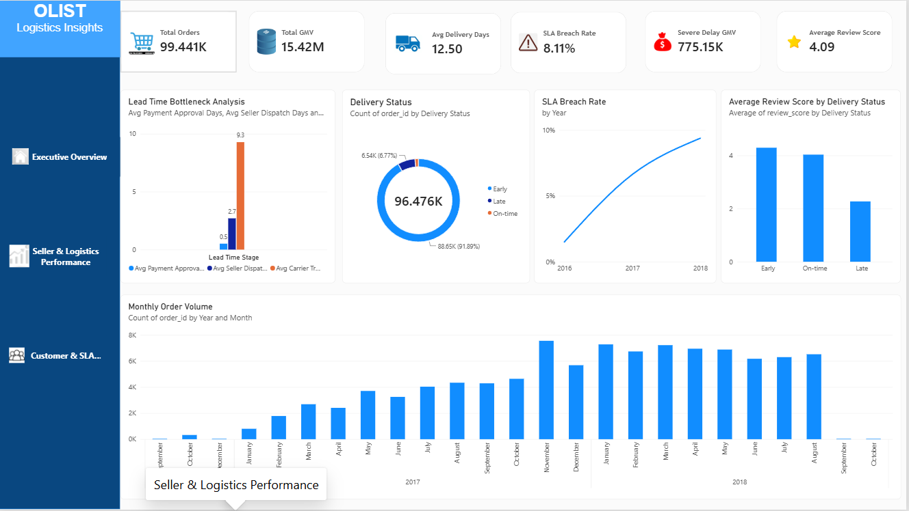
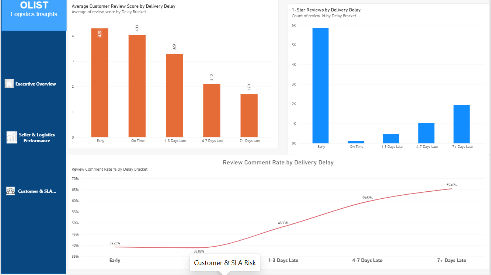

# Olist E-Commerce Data Analysis

## About the Project

I created this project using the Olist Brazilian E-Commerce dataset to understand how an online shopping business works and what problems it faces with deliveries and customer satisfaction

I used SQL to analyze the data and Power BI to create a dashboard and understand the results

## Problem I Wanted to Understand

I wanted to find out why deliveries get delayed and how these delays affect the customer experience

I explored questions like

- Are orders delivered on time
- Which stage takes the most time during delivery
- Which sellers have more shipping limit breaches
- Do delivery delays vary across different states
- How do customer reviews change when deliveries are delayed
- How much GMV is linked to severely delayed orders

## Tools I Used

- SQL and PostgreSQL
- Power BI
- DAX

## Dashboard Preview

### Executive Overview

This page shows the overall business performance including orders sales delivery time and SLA breaches

### Seller and Logistics Performance

This page focuses on seller performance shipping limit breaches and delivery time across different stages

.png)

### Customer and SLA Risk

This page shows customer reviews and how review scores vary across different delivery delay groups

## Key Findings

- Average delivery time was around 12.5 days
- SLA breach rate was around 8.11 percent
- Average carrier transit time was around 9.28 days
- GMV linked to severely delayed orders was around 775.15K
- Average customer review score was around 4.09 out of 5

These results helped me understand where delivery performance could be improved

## Challenges I Faced

While working on this project I faced some challenges

- Writing SQL queries using CTEs and window functions
- Calculating delivery time using date and timestamp columns
- Understanding relationships between different tables
- Creating DAX measures for the dashboard
- Checking the accuracy of my calculations
- Choosing the right charts to present the results clearly

Solving these problems helped me understand SQL and Power BI better and gave me practical experience with real world data

## Power BI Dashboard

[View or Download My Power BI Dashboard](https://drive.google.com/file/d/1ECOpYsazqbWP2lu560COoGhrgP8Kd_ob/view?usp=sharing)

Download the file and open it in Power BI Desktop

## Dataset

[Olist Brazilian E-Commerce Dataset on Kaggle](https://www.kaggle.com/datasets/olistbr/brazilian-ecommerce)

## What I Learned

Through this project I learned how to analyze data using SQL create measures in Power BI and present business findings through a dashboard

I also learned that understanding the data and checking calculations carefully is just as important as creating visualizations
